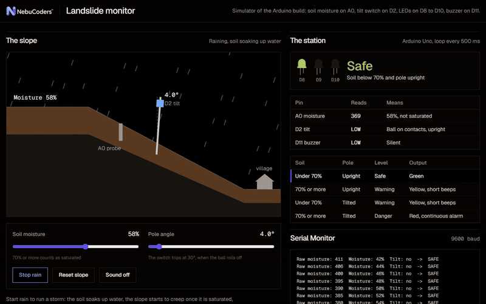
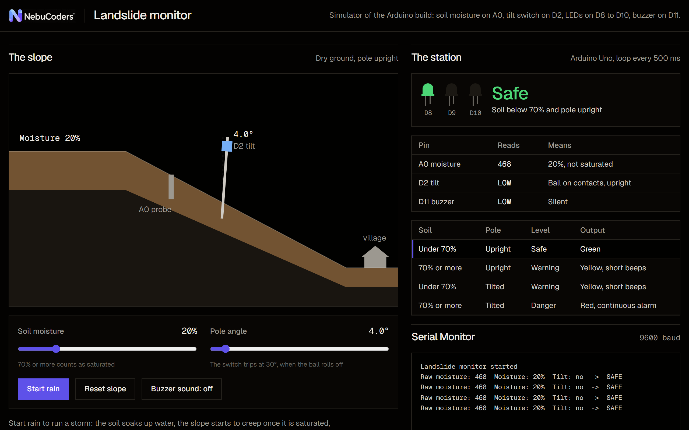
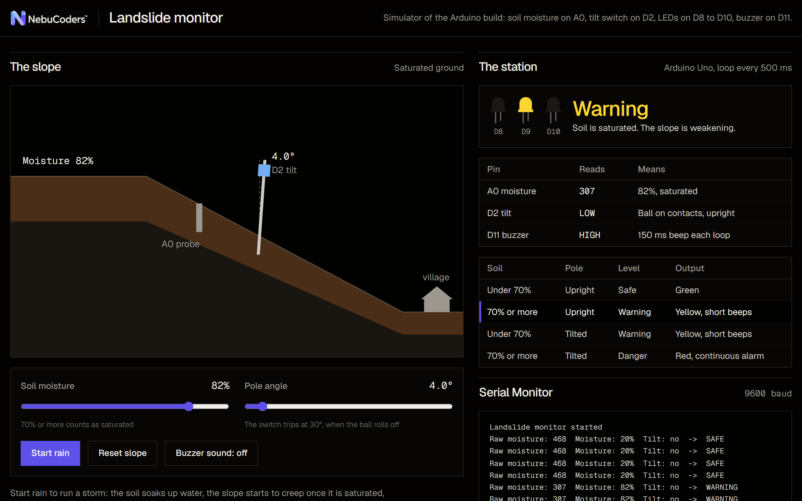
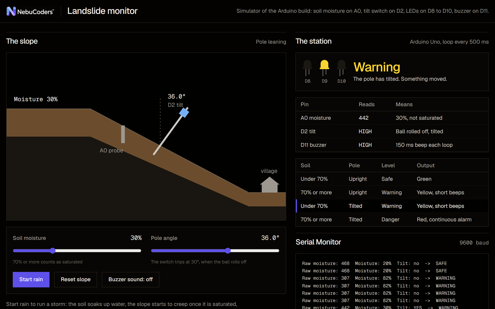
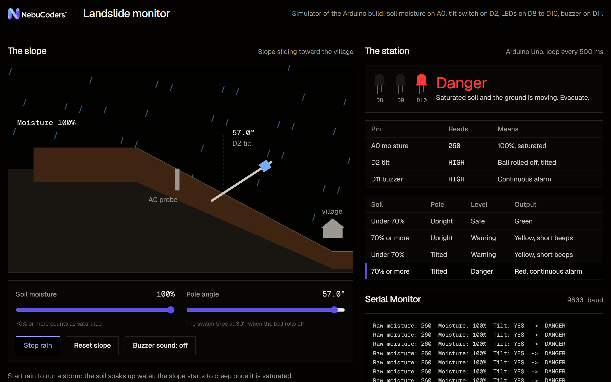
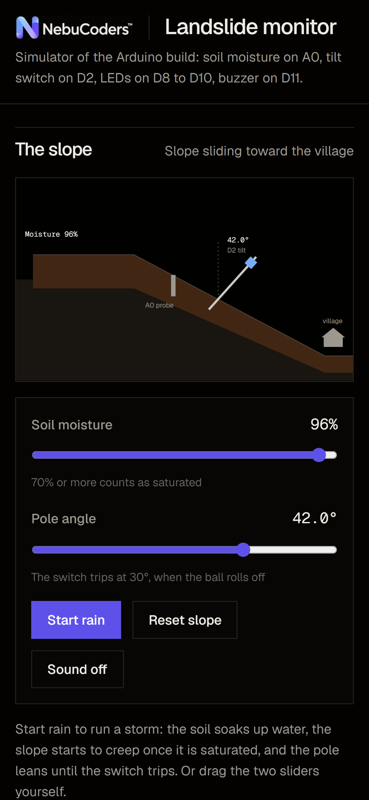
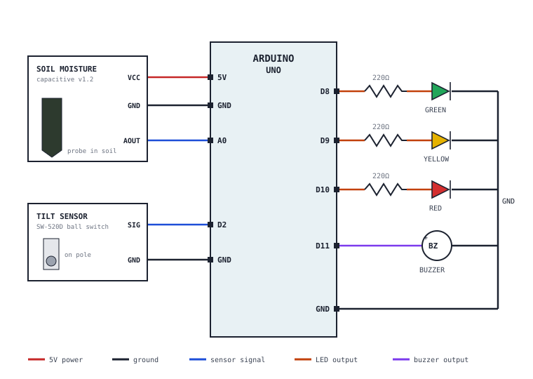

<p align="center">
  
</p>

<h1 align="center">Low-Cost Landslide Early Warning System</h1>

<p align="center">
  An Arduino monitor that watches soil moisture and ground movement on a slope,<br>
  and warns people with lights and an alarm before a landslide happens.
</p>

<p align="center">
  
  
  
</p>

<p align="center">
  
</p>

<p align="center"><a href="media/demo.mp4"><b>Watch the full demo video with sound (46 s)</b></a></p>

<p align="center"><b><a href="https://sujailxd.github.io/landslide-early-warning-system/">Open the live demo site and simulator</a></b></p>

---

## How it works

Landslides usually need two things at once: rain soaks the soil until it is heavy and weak, and then the slope starts to move. This system watches both.

- A **capacitive soil moisture sensor** is buried in the slope and measures how wet the ground is.
- A **tilt sensor (SW-520D)** is fixed to a pole pushed into the soil. While the ground holds, the pole stands straight. When the soil starts to slide, the pole leans and the switch trips.
- The **Arduino** reads both sensors twice a second and turns them into one of three levels.

| Soil moisture | Pole | Level | Output |
|---|---|---|---|
| Below 70% | Upright | 🟢 **Safe** | Green LED |
| 70% or more | Upright | 🟡 **Warning** | Yellow LED, short beeps |
| Below 70% | Tilted | 🟡 **Warning** | Yellow LED, short beeps |
| 70% or more | Tilted | 🔴 **Danger** | Red LED, continuous alarm |

Wet soil alone would set off the alarm on every rainy day, and movement alone can come too late. Wet soil gives the early warning, and movement confirms the danger.

## Screenshots

| Safe | Warning: soil saturated |
|---|---|
|  |  |
| **Warning: ground moved** | **Danger: landslide** |
|  |  |

<p align="center"></p>

## Materials

| # | Part | Qty |
|---|---|---|
| 1 | Arduino Uno (or Nano) | 1 |
| 2 | Capacitive soil moisture sensor v1.2 | 1 |
| 3 | SW-520D ball tilt sensor | 1 |
| 4 | LEDs, 5 mm: green, yellow, red | 3 |
| 5 | 220 Ω resistors | 3 |
| 6 | Active buzzer, 5 V | 1 |
| 7 | Breadboard + jumper wires | 1 set |
| 8 | USB cable or 9 V battery + clip | 1 |

The same list is in [`docs/components-list.pdf`](docs/components-list.pdf).

## Wiring

| Component | Pin | Arduino |
|---|---|---|
| Moisture sensor | VCC / GND / AOUT | 5V / GND / **A0** |
| Tilt sensor SW-520D | one leg / other leg | **D2** / GND |
| Green LED | long leg through 220 Ω | **D8** |
| Yellow LED | long leg through 220 Ω | **D9** |
| Red LED | long leg through 220 Ω | **D10** |
| All LEDs | short leg | GND |
| Active buzzer | + / − | **D11** / GND |

The tilt sensor needs no resistor, because the code turns on the Arduino's internal pull-up.

<p align="center"></p>

## Getting started

1. Wire the parts as shown above.
2. Open [`firmware/landslide_warning/landslide_warning.ino`](firmware/landslide_warning/landslide_warning.ino) in the [Arduino IDE](https://www.arduino.cc/en/software).
3. Choose **Tools → Board → Arduino Uno** and your board's port, then click **Upload**.
4. Open **Tools → Serial Monitor** at **9600 baud** to see live readings:
   ```
   Raw moisture: 302  Moisture: 84%  Tilt: no  ->  WARNING
   ```
5. **Calibrate the moisture sensor.** Note the raw value with the probe in dry air and again in a glass of water, put them in `DRY_VALUE` and `WET_VALUE` at the top of the code, and upload again.
6. **Check the tilt direction.** Upright must print `Tilt: no`. If it prints `YES`, change `HIGH` to `LOW` in `isTilted()`.

## Try it without hardware

- **Interactive simulator:** open [`simulator/index.html`](simulator/index.html) in a browser. Press **Start rain** to run a storm, or drag the moisture and tilt sliders yourself. Turn on **Buzzer sound** to hear the alarm. It also runs online at [sujailxd.github.io/landslide-early-warning-system/simulator](https://sujailxd.github.io/landslide-early-warning-system/simulator/).
- **Wokwi:** open [wokwi.com/projects/new/arduino-uno](https://wokwi.com/projects/new/arduino-uno), paste [`wokwi/sketch.ino`](wokwi/sketch.ino) and [`wokwi/diagram.json`](wokwi/diagram.json) into their tabs, and press Play. A knob stands in for the moisture sensor and a slide switch for the tilt sensor.

## Project structure

```
├── firmware/landslide_warning/landslide_warning.ino   Arduino code for the real hardware
├── wokwi/                                             Same project for the Wokwi online simulator
├── simulator/index.html                               Interactive browser simulator
├── hardware/circuit-diagram.svg                       Circuit diagram
├── docs/full-report.pdf                               Full project report (8 pages)
├── docs/components-list.pdf                           Materials list
├── media/demo.mp4, demo.gif, screenshots/             Demo video and screenshots
└── assets/                                            NebuCoders logo
```

## Ideas for upgrades

- **MPU6050 accelerometer** to measure the exact tilt angle and catch small movements early
- **SIM800L GSM module** to send SMS alerts to people's phones
- **16×2 I2C LCD** to show moisture, angle and status on a screen
- **ESP8266 / NodeMCU** for a live online dashboard over Wi-Fi
- **Solar panel + 18650 battery** to run unattended on a remote hillside

## Contact

Built by **Sujail Bin Abdullah** ([@SujailXD](https://github.com/SujailXD)) · NebuCoders

- WhatsApp: [+880 1759-230579](https://wa.me/8801759230579)
- Instagram: [@sujail_abdullah](https://instagram.com/sujail_abdullah)

## License

Released under the [MIT License](LICENSE).
